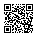

# Remote Shutter

Use one phone as a camera and another as its live viewfinder and shutter button.

**Open it on both phones: [kastrack.github.io/Remote-Shutter](https://kastrack.github.io/Remote-Shutter/)**

<a href="https://kastrack.github.io/Remote-Shutter/"></a>

Once one phone has the app open, **Open on another phone** on its start screen shows this code for the other one.

It's for the photos you can't line up from behind the camera: the back of the TV, over a crowd, a camera pushed right back against the wall, under the sink. It also works for selfies, where you check the framing from where you're standing.

- **No app, no account, no server.** It's a static web page. The phones talk directly to each other over your Wi-Fi.
- **Any combination of phones.** iPhone to Android, Android to iPhone, or two of the same.
- **Full-quality stills.** The photo is taken on the camera phone from its own camera, not grabbed from the preview video.

## Using it

Put both phones on the **same Wi-Fi**, or one on the other's **hotspot**, and open [the app](https://kastrack.github.io/Remote-Shutter/) on the phone that will take the photo. Pairing takes three steps, and both phones show which step you're on:

1. On the camera phone, tap **This phone is the camera**. It shows a code. On the other phone, open the normal **Camera app**, point it at that code, tap the link that pops up, then tap **Connect**.
2. The other phone now shows its own code. On the camera phone, tap **Next: scan the reply**.
3. Point the camera phone at the other phone's code. You're connected.

Then prop the camera phone up and use the viewer. It has a shutter button, a self-timer (3, 5 or 10 s), rotate, front/rear switch, and zoom where the phone supports it. Each photo appears on the viewer, and both phones can save it.

## Languages

The app is available in English and Simplified Chinese (简体中文). It follows the phone's language settings: the first language in the phone's list that the app supports wins. Simplified Chinese is used for `zh`, `zh-CN`, `zh-SG` and `zh-Hans`. Traditional Chinese settings (`zh-TW`, `zh-HK`, `zh-Hant`) get English. The **中文 / English** button on the start screen switches language, and the phone remembers the choice.

Each phone uses its own language, so a Chinese camera phone and an English viewer work together. To add a language, copy `docs/js/locales/en.js`, translate the values, and list the new file in `docs/js/i18n.js` and `docs/sw.js`. The unit tests check that every language has every string.

## Deploying to GitHub Pages

Everything the site needs is in `docs/`. There's no build step.

1. Go to the repository's **Settings → Pages**, choose **Deploy from a branch**, and pick `main` and the `/docs` folder.
2. The app is published at <https://kastrack.github.io/Remote-Shutter/>. All paths are relative, so a fork works at its own `https://<user>.github.io/<repo>/` without changes.

When you change any file in `docs/`, bump `VERSION` in `docs/sw.js`. That's how installed copies of the app pick up the new release. A unit test checks that the service worker's file list matches `docs/`.

The camera only works on HTTPS pages, which GitHub Pages provides.

## How pairing works

There's no signaling server, so the two WebRTC descriptions travel as QR codes:

```
camera phone                                    viewer phone
────────────                                    ────────────
getUserMedia (rear camera, up to 4K)
RTCPeerConnection (no STUN/TURN, max-bundle)
  + video sender, + data channel
createOffer, wait for ICE gathering
compact + encode ──► QR: https://…/#o=<payload> ──► native Camera app opens the link
                                                getUserMedia once, then stop it (see below)
                                                setRemoteDescription(rebuilt offer)
                                                createAnswer, wait for ICE gathering
in-page scanner (jsQR) ◄── QR: <payload> ◄───── compact + encode
setRemoteDescription(rebuilt answer)
        ═════════ DTLS, SRTP video, SCTP data channel, phone to phone ═════════
```

**The payload isn't SDP.** A full SDP is 2.5–7 KB, far too big for a QR code that scans easily. Both sides are browsers that only ever negotiate one video track and one data channel. So `docs/js/signaling-codec.js` extracts just the values that vary and packs them into about 80–110 bytes of binary:

- ICE credentials, packed at 6 or 4 bits per character
- the SHA-256 DTLS fingerprint
- the setup role
- codec payload types (H.264 constrained baseline and VP8, each with RTX)
- header-extension IDs
- SSRCs
- up to four host candidates (7 bytes each for IPv4)

The other side rebuilds a complete SDP from a template. The payload is deflated when that makes it smaller (it rarely does), then **base32**-encoded so the QR code can use its denser alphanumeric mode. The pairing link puts the payload in the URL **#fragment**, which browsers never send to any server.

**Candidates.** Only IPv4 host candidates over UDP are kept, with no duplicates and no link-local or loopback addresses. IPv6 is used only if a phone has no IPv4 address, and mDNS `.local` names only if there's nothing else.

**Why the viewer asks for camera permission.** Without it, browsers hide the phone's IP address behind a random `.local` name, which often doesn't resolve between phones. Granting permission (the app opens and immediately closes the camera) makes the browser use the real address. Only one side strictly needs a real address: the other is discovered from its connectivity checks. So pairing still usually works if the viewer refuses.

**Slow scans are fine.** The viewer's ICE checks reach the camera phone before it has scanned the reply, because the camera answers checks using only its own credentials. The connection completes as soon as the reply is scanned. A test covers a 45-second gap.

### Measured QR sizes

From `npm test` (`test/unit/payload-size.test.js`), using real Chrome and Safari SDP and the real 42-character Pages URL:

| Scenario | Offer bytes | Offer link | Offer QR | Answer bytes | Answer QR |
|---|---|---|---|---|---|
| Wi-Fi, one IPv4 | 87 | 185 chars | version 8 (49×49) | 79 | version 6 (41×41) |
| Wi-Fi + mobile data | 94 | 196 chars | version 8 | 86 | version 6 |
| iPhone hotspot host | 94 | 196 chars | version 8 | 86 | version 6 |
| Four IPv4 (worst case kept) | 108 | 218 chars | version 9 (53×53) | 100 | version 7 (45×45) |
| IPv6 only, two | 112 | 225 chars | version 9 | 102 | version 7 |
| mDNS only, two | 109 | 220 chars | version 9 | 100 | version 7 |

Every case uses error-correction level **M** with a 4-module quiet zone. For comparison, the raw SDP wouldn't fit in any QR code at level M: the largest, version 40, holds 2,331 bytes. Because the single-code path fits comfortably, there's no animated multi-part QR fallback.

## Photos

- **Captured on the camera phone**, from its own full-resolution track, never from the preview the viewer sees. The preview is scaled to about 720p at 1.5 Mbps, to keep the delay low.
- **Android (Chrome):** `ImageCapture.takePhoto()` gives a full-sensor still, capped at 16 MP. Its orientation varies by device, so the app compares the still with the live frame at all four quarter turns and keeps the best match. It then crops the still to the preview's framing, so you get what you saw.
- **iPhone (Safari) and others:** the current video frame at its native resolution (up to 4K), saved as JPEG at quality 0.92. These are video frames, so they don't get the Camera app's HDR or Night mode processing.
- **Orientation is baked into the pixels**, because canvas export drops EXIF. If the camera phone is propped sideways with rotation lock on, use **rotate** on the viewer; it turns both the preview and the photos.
- **Front camera:** the preview is mirrored, like a mirror, but the saved photo is not.
- **Saving:** browsers need a tap to save, so it never happens automatically.
  - On iPhone, **Save** opens the share sheet; choose **Save Image** to put the photo in Photos.
  - On Android, **Save** downloads to Downloads, which Google Photos and most galleries show. **Share…** is there too, for sending it elsewhere.
  - The camera phone keeps the last photo and has its own **Save last photo** button.

Photos travel over the data channel in 16 KB chunks, with flow control so the video keeps playing during the transfer. The viewer checks the size and shows progress as the polaroid "develops".

## Privacy

There are no analytics, no fonts or scripts from CDNs, and no network requests other than the page's own files. A Content-Security-Policy enforces this, and a unit test scans `docs/` for external URLs. Video and photos go phone to phone, encrypted with DTLS-SRTP.

## Development

```sh
npm install              # Playwright + the libraries vendored into docs/
npm test                 # unit tests: codec, payload sizes, QR decoding, service worker
npm run test:browser     # Chromium/Firefox/WebKit loopback and end-to-end app tests
SLOW=1 npm run test:browser   # also the 45-second slow-scan tests
npm run serve            # http://localhost:8080 (camera works on localhost)
node test/serve.js 8443 --https   # self-signed HTTPS for testing on phones on your LAN
```

Tools in `test/tools/`:

| Tool | What it does |
|---|---|
| `vendor.sh` | Refreshes `docs/vendor/` and the font from `node_modules` |
| `icons.mjs` | Renders the PNG icons from `docs/icons/icon.svg` |
| `app-qr.mjs` | Regenerates `assets/app-qr.svg`, the README's QR code for the published app |
| `capture-sdp-fixtures.mjs` | Re-captures real SDP from each engine |
| `screens.mjs` | Screenshots every screen of a paired session |

### What the automated tests cover

- **Codec:** round-trips for real offers and answers from Chromium, Firefox and WebKit. Rebuilt SDP re-parses to the same values. Candidate filtering, IPv6 and mDNS packing, base32, corrupt input, and the uncompressed fallback.
- **Cross-engine loopback:** each camera engine paired with each viewer engine, passing only the compact payload between them. Every engine accepts the rebuilt SDP in `setRemoteDescription`, video decodes, and the data channel works both ways. (Firefox↔Firefox is skipped: headless Firefox only offers mDNS names on both sides, which depends on the host's multicast DNS.)
- **End to end through the UI:** QR codes are decoded from the rendered SVGs with jsQR. The camera's real in-page scanner reads the reply from a video stream. Then shutter, a quarter-turn rotation (the photo comes back with width and height swapped), the 3-second timer, cancelling the timer, zoom (WebKit's mock camera has it) and disconnect.
- **Orientation matching:** synthetic rotated, larger, wider stills in Chromium and WebKit.

Not covered automatically: real phone cameras, `takePhoto()` on real Android hardware, iOS Safari itself, real networks and hotspots. Playwright's Linux WebKit also often crashes on `drawImage()` from a 4K camera stream (an engine bug in that build), so its end-to-end test uses a 720p mock camera. Confirm 4K stills on a real iPhone (see below).

## Manual test matrix

Run each row on real phones, with the site on GitHub Pages. "Same Wi-Fi" means both phones on one home router. For a hotspot, one phone shares its connection and the other joins it.

| # | Camera | Viewer | Network | Check |
|---|---|---|---|---|
| 1 | Android (Chrome) | iPhone (Safari) | Same Wi-Fi | Pair via native Camera on the iPhone; live view; shutter; photo appears; Save on the iPhone (share sheet → Save Image) and on the Android camera (Downloads) |
| 2 | iPhone | Android | Same Wi-Fi | Pair via native camera / Lens on Android; live view; shutter; 4K frame stills; Save and Share… on Android, Save last photo on the iPhone |
| 3 | Android | Android | Same Wi-Fi | Full-sensor `takePhoto` stills, upright in portrait and landscape; zoom slider appears and works |
| 4 | iPhone | iPhone | Same Wi-Fi | Frame stills upright in portrait and landscape; zoom shown only if reported |
| 5 | iPhone hosting hotspot | Android joined | Hotspot | **Test early.** Pairing and live view work |
| 6 | Android hosting hotspot | iPhone joined | Hotspot | **Test early.** Pairing and live view work |
| 7 | Android joined | iPhone hosting hotspot | Hotspot | The reverse roles of row 5 |
| 8 | Any | Any | Guest / office Wi-Fi with client isolation | The "Some Wi-Fi networks block devices…" hint appears; switching to a hotspot fixes it |

For each pairing, also check:

- **Front/rear switch:** the preview flips and is mirrored on the front camera; the photo is not mirrored; the next photo uses the new camera.
- **Timer:** with Off, 3 s, 5 s and 10 s, the countdown shows on both phones; the camera screen flashes red and white each second; the photo fires on time; tapping the shutter during the countdown cancels it.
- **Rotate:** with rotation lock on and the camera phone propped sideways, rotate on the viewer fixes the preview and the saved photo.
- **Robustness:**
  - Lock the viewer for 10 s, then unlock: the connection recovers, or the sheet offers **Pair again**.
  - Walk out of Wi-Fi range: you get **Connection lost** and **Pair again**.
  - Deny camera permission: you get a specific message.
  - Keep both screens on for 5 minutes (wake lock).
- **Install:** Add to Home Screen; launch the app offline with Wi-Fi on and mobile data off; pairing still works.

## Known limits

- **Same network only.** There are no STUN or TURN servers, so the phones need to reach each other directly. Some guest, office and hotel Wi-Fi blocks this ("client isolation"), and a phone hotspot is the fix.
- **Re-pairing needs both codes again.** There's no server to remember the pairing.
- **iPhone stills come from the video stream**, at up to 4K, rather than the Camera app's photo pipeline.
- **The Screen Wake Lock has been unreliable in installed home-screen apps on older iOS versions.** It works in Safari itself from iOS 16.4. If the screen dims, use the app from Safari rather than the home screen.
- **Pairing links opened inside other apps' browsers** (some QR scanner apps, or social apps) may block the camera or WebRTC. If so, open the link in Safari or Chrome.

## Licence

MIT, see [LICENSE](LICENSE). Vendored third-party code:

- [qrcode-generator](https://github.com/kazuhikoarase/qrcode-generator) (MIT)
- [jsQR](https://github.com/cozmo/jsQR) (Apache-2.0, licence in `docs/vendor/`)
- the [Jost](https://github.com/indestructible-type/Jost) font (SIL Open Font License, licence in `docs/fonts/`)
